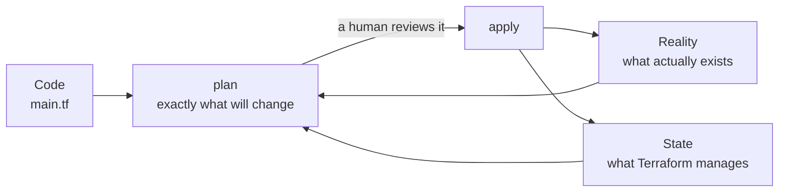

# Infrastructure as Code with Terraform

The PortoBikes story

<p class="opacity-70 pt-8">
PortoBikes is invented. Every incident in this talk really happened somewhere.
</p>

<!--
Meet PortoBikes: a bike-rental startup here in Porto. It's invented, but everything that happens to it in this talk has happened to a real company, and we'll show you which one.
-->

---
layout: center
class: text-center bg-black text-white
---

# Friday, 18:00.

## The booking server is down.

<!--
It's Friday, 18:00, peak rental time, and the booking server just died. It was set up by hand three years ago, by someone who has since left.

So: how long would it take *you* to rebuild it?

[pause]

Hold that number. We'll come back to it.
-->

---

<!-- ===== Turning point 3: Terraform arrives, plus the live demo (2017). S2 narrates, Alef drives the demo. ~13 min ===== -->

# Terraform almost didn't make it

<p class="opacity-60">📍 Real anchor</p>

- **July 2014:** Terraform v0.1 supports only **AWS** and **DigitalOcean**, chosen to prove that several **providers** could share one workflow
- Downloads were *"mostly stagnant for the first 18 months"*; the team talked about *"maybe shutting down the project"*

<v-click>

- **2017:** *"downloads continued to double every single month"*

</v-click>

<p class="absolute bottom-6 text-sm opacity-50">Mitchell Hashimoto, "The Story of HashiCorp Terraform"</p>

<!--
S2: PortoBikes, 2017. The scripts from last time describe the steps. What we want is something that describes the result. That tool existed, but it almost didn't survive.

In July 2014, Terraform 0.1 supported exactly two platforms, AWS and DigitalOcean. Two, on purpose: to prove that one workflow could drive several providers. Its creator, Mitchell Hashimoto, says downloads were "mostly stagnant for the first 18 months", and the team talked about "maybe shutting down the project".

[click] Then in 2017, "downloads continued to double every single month". So what did people suddenly see in it?
-->

---

# The core model



<p class="text-center pt-4 text-xl">You describe <b>what should exist</b>. <code>plan</code> shows exactly what will change, <b>before</b> anything happens.</p>

<!--
S2: Three inputs. The code: what we want. The state: Terraform's record of what it manages. And reality: what actually exists right now, which Terraform re-reads every time.

From those three it builds a plan: exactly what it would create, change or destroy. A person reads the plan. Only then does apply change anything.

This is the core idea of the whole talk: the change becomes something you can review.
-->

---

# Reading a plan

| Symbol | Meaning |
|---|---|
| <code class="text-green-500">+</code> | create |
| <code class="text-yellow-500">~</code> | change in place |
| <code class="text-red-500">-</code> | destroy |
| <code class="text-orange-500">-/+</code> | replace: destroy, then create |

<v-click>

```text
Plan: 1 to add, 0 to change, 1 to destroy.
```

</v-click>

<!--
S2: Four symbols, and you can read any plan. Plus: create. Tilde: change in place. Minus: destroy. And minus-slash-plus: replace, which means destroy and create again.

[click] At the bottom, a one-line summary. Watch for this exact line in a minute.
-->

---
layout: center
class: text-center
---

# → LIVE DEMO

<p class="text-2xl pt-4">Alef switches to the terminal</p>

<p class="opacity-60 pt-8">Our booking server, written down as code</p>

<!--
HAND-OFF TO THE DEMO. S2: "Let's see it. Alef, over to you." Alef switches the projector to the terminal running demo/demo.sh. Keep this slide up in the presenter view: these notes are S2's lines.

If the demo fails at any point: switch back to the slides and go to the NEXT slide (the backup recording). If it works, skip the next slide.

Step 1, `cat main.tf`, `terraform apply` (Plan: 2 to add), `curl localhost:8080` → "PortoBikes — 5 EUR per hour":
"This is our booking server, written down."

During step 1 or 2, one sentence:
"By the way, this Docker provider is maintained by one volunteer, not by HashiCorp. Remember that when we talk about who controls these tools."

Step 2, the price changes in main.tf → `terraform plan -out=tfplan` → "must be replaced", "forces replacement", "Plan: 1 to add, 0 to change, 1 to destroy.":
"Before touching anything, it tells us exactly what it will do. And notice: this replaces the server. In production that means downtime, and we found out before pressing enter."

Step 3, `terraform apply tfplan` → "Resources: 1 added, 0 changed, 1 destroyed." → the new price is live:
"What we reviewed is exactly what runs. Nothing gets recalculated."

Step 4, `docker rm -f portobikes-web` → the page stops loading:
"Friday, 18:00."

Step 5, `terraform plan -out=tfplan` → "will be created", "Plan: 1 to add":
"Terraform re-read reality, saw the server is gone, and wants to put it back. That's drift detection."

Step 6, `terraform apply tfplan` → "Resources: 1 added", no `yes` prompt → the page is back:
"So, how long did it take you to rebuild yours?"

The terminal then shows "Back to the slides". DON'T DESTROY: the server keeps running until the debate, where OpenTofu takes it over. Leave the terminal window open.

Demo-day warnings:
- Terraform does NOT print "Objects have changed outside of Terraform" when the container is deleted. The plan just says "will be created". Don't promise the class a warning message.
- Never use -refresh=false or -minimal-refresh: both hide the drift.
- Before the talk: terraform init on the demo laptop, nginx:alpine pre-pulled, port 8080 free, DOCKER_HOST set on Colima (demo/README.md). demo.sh checks these.
-->

---
layout: center
class: text-center
---

# Backup: the demo, recorded

<video src="/recording.mp4#t=0,81" controls preload="auto" class="mx-auto max-h-[55vh] rounded shadow"></video>

<p class="text-sm opacity-50 pt-2">Only if the live demo fails. Same steps, same output: it stops when turning point 3 is done.</p>

<!--
ONLY IF THE LIVE DEMO FAILED. If the demo worked, skip this slide.

Press play. S2 says the same lines as in the demo notes on the previous slide, a little behind the video. The video stops by itself after step 6 (about 1:20), before the OpenTofu part, which belongs to the debate.

If the live demo died partway through, drag the video to where it died: apply at the start, the price change after about 0:30, the deletion after about 0:55.
-->

---
layout: center
class: text-center
---

# ← Back to the slides

<div class="text-2xl leading-loose pt-4">

What we reviewed is exactly what ran.

The server died, and `plan` put it back.

</div>

<!--
RETURN FROM THE DEMO. Alef switches the projector back to the slides. The terminal stays open with the server running: the debate uses it.

S2: "So: what we reviewed is exactly what ran. And when someone deleted the server by hand, the plan noticed and put it back."
-->

---

# Same workflow, another platform

<div class="grid grid-cols-2 gap-6">

<div>

**The demo** (Docker)

```hcl
provider "docker" {}

resource "docker_container" "web" {
  name  = "portobikes-web"
  image = docker_image.nginx.image_id
  # ...
}
```

</div>

<div>

**PortoBikes on AWS**

```hcl
provider "aws" {
  region = "eu-south-2"
}

resource "aws_instance" "web" {
  ami           = var.ami_id
  instance_type = "t3.micro"
  # ...
}
```

</div>

</div>

<p class="pt-4">Swap the <b>provider</b> and its resource types. <code>init</code> → <code>plan</code> → <code>apply</code> stays the same.</p>

<!--
BACKUP SLIDE: show it if someone asks "but that's just Docker on a laptop", otherwise skip it.

S2: The demo ran on Docker so it costs nothing and needs no Wi-Fi. For AWS you'd switch the provider and use AWS's resource types, but the workflow is the same: init, plan, review, apply. That's the multi-provider bet from 2014.

Be honest if asked: the AWS side is a sketch for the slide, not code we ran.
-->

---

# How Terraform changed, 0.x → 1.x

<div class="text-[0.85em] [&_td]:py-1 [&_th]:py-1">

| Version | When | What changed |
|---|---|---|
| 0.1 | Jul 2014 | AWS and DigitalOcean only |
| 0.12 | May 2019 | HCL2: a real expression language |
| 0.13 | Aug 2020 | Providers installed from the Registry |
| **1.0** | **Jun 2021** | **A compatibility promise: upgrades within 1.x keep your configuration working** |
| 1.5 | Jun 2023 | Import through a plan |
| 1.6 | Oct 2023 | `terraform test`, and the first BSL release |
| 1.11 | Feb 2025 | S3 locks state itself |
| 1.17 | Oct 2026 | Terraform Policy is generally available |

</div>

<v-click>

<p class="text-xl pt-2">After 1.0, new features increasingly work <b>through the plan</b>.</p>

</v-click>

<!--
S2: How did it change since it started? 0.1 had two providers. 0.12, in 2019, made HCL a real language. 0.13 is why `source = "kreuzwerker/docker"` just worked in the demo: providers come from the Registry.

1.0, in June 2021, is the maturity line: HashiCorp promised that upgrades within 1.x keep your configuration working.

After that: 1.5 lets you import hand-made infrastructure through a reviewed plan. 1.6 adds `terraform test`, and it's also the first release under the BSL; keep that in mind for later. 1.11: S3 locks state by itself, which matters in a minute when the team grows. And last month, 1.17: Terraform Policy, rules checked against every plan.

[click] Notice the pattern: after 1.0, new features increasingly work through the plan. Which is exactly what PortoBikes needs next, because the team is about to grow.
-->

---
layout: center
class: text-center
---

# Friday, 18:00. The booking server is down.

<v-click>

```bash
terraform apply
```

</v-click>

<v-click>

## Back within seconds.

</v-click>

<!--
At the start, we asked how long it would take you to rebuild that server.

[click] terraform apply.

[click] You just watched it take seconds.
-->

---
layout: center
---

<p class="text-3xl leading-relaxed">
Terraform turned infrastructure into reviewable code, and everything since has been about who reviews it: colleagues, policies, and now AI.
</p>

<!--
Terraform turned infrastructure into reviewable code, and everything since has been about who reviews it: colleagues, policies, and now AI.
-->

---
layout: center
class: text-center
---

# Run the demo yourself


[github.com/Alef-Keuffer/terraform-portobikes](https://github.com/Alef-Keuffer/terraform-portobikes)

<!--
Everything you saw, the demo included, is in this repo. Scan the code and run it yourself. Thank you, and now your questions.
-->
