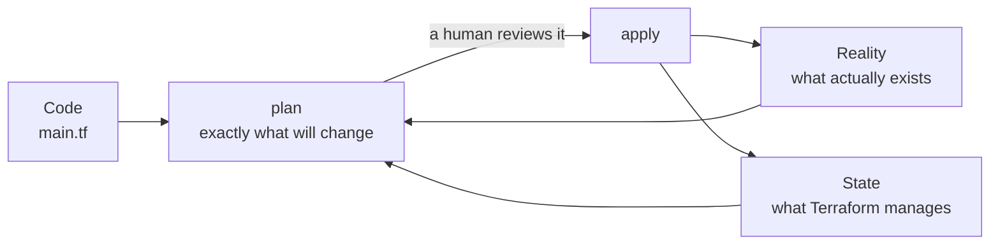

# Infrastructure as Code with Terraform

The PortoBikes story

<p class="opacity-70 pt-8">
PortoBikes is invented. Every incident in this talk really happened somewhere.
</p>

<!--
Meet PortoBikes: a bike-rental startup here in Porto. It's invented, but everything that happens to it in this talk has happened to a real company, and we'll show you which one.
-->

---
layout: center
class: text-center bg-black text-white
---

# Friday, 18:00.

## The booking server is down.

<!--
It's Friday, 18:00, peak rental time, and the booking server just died. It was set up by hand three years ago, by someone who has since left.

So: how long would it take *you* to rebuild it?

[pause]

Hold that number. We'll come back to it.
-->

---

# PortoBikes, 2015

Two founders. One AWS account. The console.

<v-click>

<p class="text-5xl pt-12 text-center">"It works!"</p>

</v-click>

<!--
[S1] Let's rewind to how that server was born. 2015. PortoBikes is two founders, a few bikes and an AWS account. One of them opens the AWS console, clicks "launch instance", picks a size, opens a port, and installs the booking app by hand.

[click] It works! And honestly, for two people, that was the right call. The console is fast, it's visual, and you can learn it in an afternoon.

We call this ClickOps: managing infrastructure by hand, through web consoles. The cost is hidden, and it arrives later. Because nothing was written down. There's no file you can read, no change anyone can review, nothing you can repeat.
-->

---

# What goes wrong

<v-clicks>

- **Snowflake servers**: hand-tuned until each one is unique.<br>*"Good for a ski resort, bad for a data center."*
- **Staging and production** quietly stop matching
- **Only one person** knows how to rebuild it

</v-clicks>

<p class="absolute bottom-4 left-14 right-14 text-xs opacity-60">Quote: Martin Fowler, "SnowflakeServer" (2012), martinfowler.com</p>

<!--
[S1] Here's how it goes wrong.

[click] First, snowflake servers. That's Martin Fowler's name, from 2012, for a server hand-tuned through command lines, GUI screens and text-file edits until it's unique. His line: good for a ski resort, bad for a data center.

[click] Second, staging and production quietly stop matching. Someone fixes production at midnight and forgets staging. Now a bug shows up in one and not the other, and nobody can say which difference caused it.

[click] And third, the one we opened with: only one person knows how to rebuild it. When that machine dies on a Friday at 18:00, the only documentation is the dead machine.
-->

---

# Pets vs cattle

<div class="grid grid-cols-2 gap-8 pt-6">
<div>

### Pets 🐶

*"indispensable or unique systems that can never be down"*

Named, nursed back to health.

</div>
<div>

### Cattle 🐄

*"built using automated tools, and … designed for failure"*

Replaced, not repaired.

</div>
</div>

<p class="text-2xl pt-10 text-center">Stop nursing servers. Make them replaceable.</p>

<p class="absolute bottom-4 left-14 right-14 text-xs opacity-60">Quotes: Randy Bias, "The History of Pets vs Cattle" (2016), cloudscaling.com</p>

<!--
[S1] There's a well-known way to put the fix: pets versus cattle.

A pet is a server you treat as indispensable and unique. It has a name, and when it gets sick, you nurse it back to health. Cattle are built with automated tools and designed for failure. When one gets sick, you replace it.

Randy Bias spread this framing for the cloud, and he credits the metaphor to Bill Baker at Microsoft.

PortoBikes' booking server is a pet with a name. Friday at 18:00 is the moment the pet dies. So the goal from here on is replaceable servers.
-->

---

# 📍 Knight Capital, 2012

A deployment to **8 servers**. One was missed. Nobody double-checked.

<v-click>

<p class="text-6xl font-bold pt-6 pb-6">$460M lost in ~45 minutes</p>

</v-click>

<v-click>

> *"A written procedure requiring a simple double-check of the deployment … could have identified that a server had been missed."*

</v-click>

<p class="absolute bottom-4 left-14 right-14 text-xs opacity-60">Source: SEC, In the Matter of Knight Capital Americas LLC, Release No. 34-70694 (2013), ¶15–17, ¶41</p>

<!--
[S1] Does this happen to real companies? Knight Capital, 2012, a US trading firm. They were deploying new code to eight servers. One technician didn't copy the new code to one of the eight, and no second person reviewed the deployment. That eighth server still had old, unused code on it, and live orders woke it up.

[click] In about 45 minutes it sent four million executions into the market. Knight lost 460 million dollars.

[click] The SEC investigated, and its order says: a written procedure requiring a simple double-check of the deployment could have identified that a server had been missed.

One person did it, and nobody checked. Remember that word: review. It's the thread of this talk.
-->

---

# 📍 AWS S3, 2017

An engineer follows a playbook and types a command by hand.

> *"One of the inputs to the command was entered incorrectly and a larger set of servers was removed than intended."*

<v-click>

<p class="text-5xl font-bold pt-6 pb-6">S3 in us-east-1: offline for ~4 hours</p>

</v-click>

<p class="absolute bottom-4 left-14 right-14 text-xs opacity-60">Source: AWS, "Summary of the Amazon S3 Service Disruption in the Northern Virginia (US-EAST-1) Region" (2017), aws.amazon.com/message/41926</p>

<!--
[S1] A second one, from AWS itself. February 2017. An S3 engineer, following an established playbook, runs a command to remove a few servers from a billing system. One input is typed wrong, and a much larger set of servers is removed, including the ones holding S3's index of where every object lives.

[click] S3 in us-east-1 was down for about four hours.

To be fair: this wasn't console clicking. It was a command typed by hand from a written procedure, so call it manual operations. The lesson is the same. A human typing values into a live system, with no preview of what's about to happen.
-->

---

# Infrastructure as Code

Managing infrastructure through **machine-readable definition files** kept in **version control**, instead of clicking in consoles or running ad-hoc scripts.

<v-click>

The term emerged **around 2009**, in the DevOps, Puppet and Chef community. No single inventor.

</v-click>

<p class="absolute bottom-4 left-14 right-14 text-xs opacity-60">Origin: Kief Morris, infrastructure-as-code.com/book</p>

<!--
[S1] So what's the alternative? Infrastructure as Code: managing infrastructure through machine-readable definition files kept in version control, instead of clicking in consoles or running ad-hoc scripts.

[click] Where does the term come from? There's no single inventor. Kief Morris, who wrote the O'Reilly book on it, traces its earliest uses to a 2009 conference talk by Andrew Clay Shafer, with the founders of Chef and Puppet using the phrase around the same time.

The idea that matters for us: if infrastructure is a file, a change is a diff. And a diff can be reviewed.
-->

---

# What IaC buys you

<v-clicks>

- **Speed**: new servers by *"running the script"*; environments *"within minutes"*
- **Consistency**: *"the same environment every time it deploys"*
- **An audit trail**: *"every change … can be logged"*
- **Safe rollback** to *"the last working configuration"*
- **Disaster recovery**: *"you should always deploy using infrastructure as code"*
- **Identical copies**: *"the same environment … in another location using the same IaC"*

</v-clicks>

<p class="absolute bottom-4 left-14 right-14 text-xs opacity-60">Sources: Martin Fowler, "InfrastructureAsCode" (2016); AWS, "What is IaC?"; Microsoft Learn, "What is infrastructure as code?"; AWS, Disaster Recovery of Workloads on AWS</p>

<!--
[S1] What does that buy you? Six things.

[click] Speed. In Fowler's words, creating new servers is just a case of running the script. AWS says environments within minutes.

[click] Consistency. Microsoft: the same environment every time it deploys.

[click] An audit trail. Every change can be logged, so you know who changed what.

[click] Safe rollback. At worst, you go back to the last working configuration.

[click] Disaster recovery. AWS's own guide says you should always deploy using infrastructure as code, so infrastructure can be redeployed quickly without errors. That's our Friday 18:00 problem.

[click] And identical copies: the same environment, in another location, from the same code. That's how staging actually matches production.
-->

---

# PortoBikes, 2016: scripts in Git

```bash
./create-servers.sh
git commit -m "Write down how we build the servers"
```

<v-click>

The steps are **repeatable**, and they have a **history**. That's progress.

</v-click>

<!--
[S1] So after that Friday, PortoBikes does the sensible thing. It's 2016. They write every step down as Bash scripts using the AWS command line, and put the scripts in Git.

[click] That's real progress. The steps are repeatable, anyone on the team can run them, and Git keeps a history of who changed what. If the server dies on a Friday, you don't need the one person who remembers. You run the script. So, problem solved? Not quite. There's a catch, and it's subtle.
-->

---

# Imperative vs declarative

<div class="grid grid-cols-2 gap-6 pt-2 big-code">
<div>

**Bash**: the steps

```bash
aws ec2 run-instances \
  --image-id ami-0fb653ca2d3203ac1 \
  --instance-type t2.micro \
  --count 2
```

Run it twice → **4 servers**

</div>
<div>

**Terraform**: the result

```hcl
resource "aws_instance" "web" {
  count         = 2
  ami           = "ami-0fb653ca2d3203ac1"
  instance_type = "t2.micro"
}
```

Run it twice → **2 servers**

</div>
</div>

<style>
.big-code .slidev-code { font-size: 0.95rem !important; line-height: 1.6 !important; }
.big-code p { font-size: 1.4rem; }
</style>

<!--
[S1] Here's the catch, in code.

On the left, the Bash script. It says: run two instances. That's imperative: you write the steps. Run it once, you have two servers. Run it again, by accident or to fix a half-failed run, and you have four. The script has no idea what already exists. You could add checks: if two servers exist, skip. But every author has to remember that, for every step, in every script.

On the right, Terraform. It doesn't say "create". It says: there should be two of these. That's declarative: you describe the end state, and the tool works out the steps. Run it twice and you still have two. Change the 2 to a 3, and Terraform tells you: one to add.

Scripts describe the steps. Declarative code describes the result. And because the tool knows the result you want, it can tell you what it's about to change before it changes anything. Keep that in mind for the demo.
-->

---

# Configure vs create

<div class="grid grid-cols-2 gap-8 pt-4">
<div>

### Configuration management

**Configures** machines that already exist

CFEngine (1993) · Puppet (2005)<br>Chef (2009) · Ansible (2012)

</div>
<div>

### Provisioning

**Creates** the infrastructure itself

CloudFormation (2011)<br>Terraform (2014)

</div>
</div>

<!--
[S1] Around this time you'd also meet configuration management tools: CFEngine from 1993, Puppet from 2005, Chef from 2009, Ansible from 2012. They're good tools, and mostly declarative too. But they answer a different question: what's installed and configured on this machine? Packages, files, services.

Ansible would have helped PortoBikes rebuild the software on the dead server. But someone still has to create the server, the firewall, the DNS record. That half is still ClickOps.

Provisioning tools answer that question: which machines, networks and databases should exist? CloudFormation, from 2011, and Terraform, from 2014.

If someone asks: yes, Ansible can create EC2 instances, and some of its modules are declarative. This is about where each tool is strongest, not a hard wall.
-->

---

# CloudFormation had the right idea, inside AWS

<v-clicks>

- **Declarative**, and from 2016 it **previewed changes** (change sets)
- But it runs **only in AWS** and can't manage a second cloud
- Non-AWS services work only where a vendor has published a type (since 2021)

</v-clicks>

<p class="absolute bottom-4 left-14 right-14 text-xs opacity-60">Sources: AWS What's New, change sets (2016-03) and CloudFormation Public Registry (2021-06-21)</p>

<!--
[S1] And CloudFormation had the right idea.

[click] It was declarative, and from 2016 it could even preview a change before running it, with change sets. So Terraform did not invent the preview.

[click] The limit was elsewhere: CloudFormation runs only inside AWS. It can't manage a second cloud.

[click] Since 2021, other vendors can publish resource types for it, so some outside services work. But PortoBikes' DNS at an outside registrar, its monitoring service: all of that stays ClickOps.

What PortoBikes wants is one tool and one workflow for everything. And that's what HashiCorp claims for Terraform: a consistent workflow to provision and manage all of your infrastructure, with a plan you approve first. Which brings us to 2017.
-->

---

<!-- ===== Turning point 3: Terraform arrives, plus the live demo (2017). S2 narrates, Alef drives the demo. ~13 min ===== -->

# Terraform almost didn't make it

<p class="opacity-60">📍 Real anchor</p>

- **July 2014:** Terraform v0.1 supports only **AWS** and **DigitalOcean**, chosen to prove that several **providers** could share one workflow
- Downloads were *"mostly stagnant for the first 18 months"*; the team talked about *"maybe shutting down the project"*

<v-click>

- **2017:** *"downloads continued to double every single month"*

</v-click>

<p class="absolute bottom-6 text-sm opacity-50">Mitchell Hashimoto, "The Story of HashiCorp Terraform"</p>

<!--
S2: PortoBikes, 2017. The scripts from last time describe the steps. What we want is something that describes the result. That tool existed, but it almost didn't survive.

In July 2014, Terraform 0.1 supported exactly two platforms, AWS and DigitalOcean. Two, on purpose: to prove that one workflow could drive several providers. Its creator, Mitchell Hashimoto, says downloads were "mostly stagnant for the first 18 months", and the team talked about "maybe shutting down the project".

[click] Then in 2017, "downloads continued to double every single month". So what did people suddenly see in it?
-->

---

# The core model



<p class="text-center pt-4 text-xl">You describe <b>what should exist</b>. <code>plan</code> shows exactly what will change, <b>before</b> anything happens.</p>

<!--
S2: Three inputs. The code: what we want. The state: Terraform's record of what it manages. And reality: what actually exists right now, which Terraform re-reads every time.

From those three it builds a plan: exactly what it would create, change or destroy. A person reads the plan. Only then does apply change anything.

This is the core idea of the whole talk: the change becomes something you can review.
-->

---

# Reading a plan

| Symbol | Meaning |
|---|---|
| <code class="text-green-500">+</code> | create |
| <code class="text-yellow-500">~</code> | change in place |
| <code class="text-red-500">-</code> | destroy |
| <code class="text-orange-500">-/+</code> | replace: destroy, then create |

<v-click>

```text
Plan: 1 to add, 0 to change, 1 to destroy.
```

</v-click>

<!--
S2: Four symbols, and you can read any plan. Plus: create. Tilde: change in place. Minus: destroy. And minus-slash-plus: replace, which means destroy and create again.

[click] At the bottom, a one-line summary. Watch for this exact line in a minute.
-->

---
layout: center
class: text-center
---

# → LIVE DEMO

<p class="text-2xl pt-4">Alef switches to the terminal</p>

<p class="opacity-60 pt-8">Our booking server, written down as code</p>

<!--
HAND-OFF TO THE DEMO. S2: "Let's see it. Alef, over to you." Alef switches the projector to the terminal running demo/demo.sh. Keep this slide up in the presenter view: these notes are S2's lines.

If the demo fails at any point: switch back to the slides and go to the NEXT slide (the backup recording). If it works, skip the next slide.

Step 1, `cat main.tf`, `terraform apply` (Plan: 2 to add), `curl localhost:8080` → "PortoBikes — 5 EUR per hour":
"This is our booking server, written down."

During step 1 or 2, one sentence:
"By the way, this Docker provider is maintained by one volunteer, not by HashiCorp. Remember that when we talk about who controls these tools."

Step 2, the price changes in main.tf → `terraform plan -out=tfplan` → "must be replaced", "forces replacement", "Plan: 1 to add, 0 to change, 1 to destroy.":
"Before touching anything, it tells us exactly what it will do. And notice: this replaces the server. In production that means downtime, and we found out before pressing enter."

Step 3, `terraform apply tfplan` → "Resources: 1 added, 0 changed, 1 destroyed." → the new price is live:
"What we reviewed is exactly what runs. Nothing gets recalculated."

Step 4, `docker rm -f portobikes-web` → the page stops loading:
"Friday, 18:00."

Step 5, `terraform plan -out=tfplan` → "will be created", "Plan: 1 to add":
"Terraform re-read reality, saw the server is gone, and wants to put it back. That's drift detection."

Step 6, `terraform apply tfplan` → "Resources: 1 added", no `yes` prompt → the page is back:
"So, how long did it take you to rebuild yours?"

The terminal then shows "Back to the slides". DON'T DESTROY: the server keeps running until the debate, where OpenTofu takes it over. Leave the terminal window open.

Demo-day warnings:
- Terraform does NOT print "Objects have changed outside of Terraform" when the container is deleted. The plan just says "will be created". Don't promise the class a warning message.
- Never use -refresh=false or -minimal-refresh: both hide the drift.
- Before the talk: terraform init on the demo laptop, nginx:alpine pre-pulled, port 8080 free, DOCKER_HOST set on Colima (demo/README.md). demo.sh checks these. The provider version is pinned by the committed .terraform.lock.hcl.
-->

---
layout: center
class: text-center
---

# Backup: the demo, recorded

<video src="/recording.mp4#t=0,79.9" controls preload="auto" class="mx-auto max-h-[55vh] rounded shadow"></video>

<p class="text-sm opacity-50 pt-2">Only if the live demo fails. Same steps, same output: it stops when turning point 3 is done.</p>

<!--
ONLY IF THE LIVE DEMO FAILED. If the demo worked, skip this slide.

Press play. S2 says the same lines as in the demo notes on the previous slide, a little behind the video. The video stops by itself at step 6's "Apply complete! Resources: 1 added" (about 1:20). Say "and the page is back" yourself: the frame that shows the page also shows the OpenTofu line from the debate, so the video stops just before it.

If the live demo died partway through, drag the video to where it died: apply at the start, the price change after about 0:30, the deletion after about 0:55.
-->

---
layout: center
class: text-center
---

# ← Back to the slides

<div class="text-2xl leading-loose pt-4">

What we reviewed is exactly what ran.

The server died, and `plan` put it back.

</div>

<!--
RETURN FROM THE DEMO. Alef switches the projector back to the slides. The terminal stays open with the server running: the debate uses it.

S2: "So: what we reviewed is exactly what ran. And when someone deleted the server by hand, the plan noticed and put it back."
-->

---

# Same workflow, another platform

<div class="grid grid-cols-2 gap-6">

<div>

**The demo** (Docker)

```hcl
provider "docker" {}

resource "docker_container" "web" {
  name  = "portobikes-web"
  image = docker_image.nginx.image_id
  # ...
}
```

</div>

<div>

**PortoBikes on AWS** <span class="opacity-50">(a sketch, not run)</span>

```hcl
provider "aws" {
  region = "eu-south-2"
}

resource "aws_instance" "web" {
  ami           = var.ami_id
  instance_type = "t3.micro"
  # ...
}
```

</div>

</div>

<p class="pt-4">Swap the <b>provider</b> and its resource types. <code>init</code> → <code>plan</code> → <code>apply</code> stays the same.</p>

<!--
BACKUP SLIDE: show it if someone asks "but that's just Docker on a laptop", otherwise skip it.

S2: The demo ran on Docker so it costs nothing and needs no Wi-Fi. For AWS you'd switch the provider and use AWS's resource types, but the workflow is the same: init, plan, review, apply. That's the multi-provider bet from 2014.

Be honest if asked: the AWS side is a sketch for the slide, not code we ran.
-->

---

# How Terraform changed, 0.x → 1.x

<div class="text-[0.85em] [&_td]:py-1 [&_th]:py-1">

| Version | When | What changed |
|---|---|---|
| 0.1 | Jul 2014 | AWS and DigitalOcean only |
| 0.12 | May 2019 | HCL2: a real expression language |
| 0.13 | Aug 2020 | Providers installed from the Registry |
| **1.0** | **Jun 2021** | **A compatibility promise: upgrades within 1.x keep your configuration working** |
| 1.5 | Jun 2023 | Import through a plan |
| 1.6 | Oct 2023 | `terraform test`, and the first BSL release |
| 1.11 | Feb 2025 | S3 locks state itself |
| 1.17 | Oct 2026 | Terraform Policy is generally available |

</div>

<v-click>

<p class="text-xl pt-2">After 1.0, new features increasingly work <b>through the plan</b>.</p>

</v-click>

<!--
S2: How did it change since it started? 0.1 had two providers. 0.12, in 2019, made HCL a real language. 0.13 is why `source = "kreuzwerker/docker"` just worked in the demo: providers come from the Registry.

1.0, in June 2021, is the maturity line: HashiCorp promised that upgrades within 1.x keep your configuration working.

After that: 1.5 lets you import hand-made infrastructure through a reviewed plan. 1.6 adds `terraform test`, and it's also the first release under the BSL; keep that in mind for later. 1.11: S3 locks state by itself, which matters in a minute when the team grows. And last month, 1.17: Terraform Policy, rules checked against every plan.

[click] Notice the pattern: after 1.0, new features increasingly work through the plan. Which is exactly what PortoBikes needs next, because the team is about to grow.
-->

---

# 2019: ten engineers, one state file

- Two people run `terraform apply` at once: both read the same old **state**, and one write is lost
- Fix: shared remote state with **locking**. Terraform locks state on every operation that writes it
- Since Terraform 1.11 (Feb 2025), S3 locks state itself; the DynamoDB lock table is deprecated

```hcl {6}
terraform {
  backend "s3" {
    bucket       = "portobikes-state"
    key          = "prod/terraform.tfstate"
    region       = "eu-west-1"
    use_lockfile = true # defaults to false: forget it, and there is no lock
  }
}
```

<p class="text-sm opacity-80">Terraform docs: state locking; S3 backend; 1.11 changelog.</p>

<!--
[S2]

Fast-forward to 2019. PortoBikes has grown to ten engineers, and they all run Terraform from their own laptops.

Here's the problem. Terraform keeps its state, its record of what it manages, in a file. If two people run apply at the same moment, both read the same old state, both write, and one of the writes is lost. Now you have infrastructure that exists, but that Terraform no longer knows about.

The fix is to put the state in one shared place, with a lock. Terraform takes the lock automatically on every operation that writes state. If someone else already holds it, Terraform stops instead of writing.

On AWS, the classic setup was an S3 bucket for the state and a DynamoDB table for the lock. Since Terraform 1.11, in February 2025, S3 can hold the lock itself, and the DynamoDB arguments are deprecated.

[point at the highlighted line] One trap: this setting defaults to false. Forget that line, and you have shared state with no lock at all.
-->

---

# Every change is a pull request

1. Open a pull request with the HCL change
2. CI runs `terraform plan` and posts it to the pull request
3. A colleague reviews the **plan**, not just the code
4. Approval, then `apply`

<div class="grid grid-cols-3 gap-4 pt-6 text-center">
  <div class="border-2 border-current rounded p-3"><b>Atlantis</b><br>open source, self-hosted</div>
  <div class="border-2 border-current rounded p-3"><b>GitHub Actions</b><br>runs the plan in CI</div>
  <div class="border-2 border-current rounded p-3"><b>HCP Terraform</b><br>HashiCorp's hosted service</div>
</div>

<p class="pt-6">Why review the plan? A three-line diff can hide a replaced database. The plan says <code>must be replaced</code>.</p>

<!--
[S2]

With ten engineers, nobody should be running apply from a laptop anyway. So the change process becomes a pull request.

You open a pull request with your change. CI runs terraform plan and posts the result on the pull request. A colleague reviews it. And here's the important part: they review the *plan*, not just the code. Only after approval does anything get applied.

Why the plan? Because a three-line change in the code can hide something destructive, like an attribute that forces the database to be replaced. The code diff looks harmless. The plan says "must be replaced". You saw exactly that in the demo, when changing a price replaced our server.

Three tools implement this same loop. Atlantis is open source and self-hosted. You comment "atlantis plan" on the pull request, and it can refuse to apply until someone other than the author has approved. GitHub Actions can run the plan in CI. And HCP Terraform, HashiCorp's hosted service, plans every pull request on its own.

This is where the talk's argument becomes concrete: reviewable code became reviewable change.
-->

---

# Where IaC sits in a DevOps pipeline

<div class="flex flex-col gap-6 pt-4 text-xl font-semibold">
  <div>
    <div class="text-sm uppercase tracking-wide opacity-80 pb-2">On the pull request</div>
    <div class="flex items-center gap-3">
      <div class="border-2 border-current rounded px-4 py-3 whitespace-nowrap">commit</div>
      <div class="text-3xl" aria-hidden="true">→</div>
      <div class="border-2 border-current rounded px-4 py-3 whitespace-nowrap">pull request</div>
      <div class="text-3xl" aria-hidden="true">→</div>
      <div class="border-2 border-current rounded px-4 py-3 whitespace-nowrap">CI: <code>init</code> + <code>plan</code></div>
      <div class="text-3xl" aria-hidden="true">→</div>
      <div class="border-4 border-amber-500 bg-amber-300 text-black rounded px-4 py-3">a human reviews the plan</div>
    </div>
  </div>
  <div>
    <div class="text-sm uppercase tracking-wide opacity-80 pb-2">After approval</div>
    <div class="flex items-center gap-3">
      <div class="text-3xl" aria-hidden="true">→</div>
      <div class="border-2 border-current rounded px-4 py-3 whitespace-nowrap">merge</div>
      <div class="text-3xl" aria-hidden="true">→</div>
      <div class="border-2 border-current rounded px-4 py-3 whitespace-nowrap"><code>apply</code> the saved plan</div>
      <div class="text-3xl" aria-hidden="true">→</div>
      <div class="border-2 border-current rounded px-4 py-3 whitespace-nowrap">app deploy</div>
    </div>
  </div>
</div>

<div class="pt-8 text-base">

HashiCorp: initialize, produce a plan, *"have a human operator review that plan"*, apply.<br>
DORA: version your "Terraform files" too; comprehensive version control *"predicts continuous delivery"*.

</div>

<!--
[S2]

So where does all this sit in a DevOps pipeline? Here's the whole picture.

[top row] A commit goes into a pull request. CI runs terraform init and terraform plan. And then, in yellow, the step this whole talk is about: a human reviews the plan.

[bottom row] After approval, the change is merged, CI applies a *saved* plan, so what runs is exactly what that plan showed, and only then does the application get deployed onto that infrastructure.

This isn't our invention. HashiCorp's own guide to running Terraform in automation lists the same four steps: initialize, produce a plan, "have a human operator review that plan", apply.

And DORA, Google's DevOps research programme, says teams should keep their Terraform files in version control, because comprehensive version control "predicts continuous delivery".

So that's the relationship between IaC and DevOps: the infrastructure goes through the same pull request, review and deploy loop as the application, and it comes first.
-->

---

# A plan people can review, machines can check

**Policy as code:** rules checked against every plan, before `apply`

<div class="grid grid-cols-3 gap-4 pt-6 text-center">
  <div class="border-2 border-current rounded p-3"><b>Sentinel</b><br>HashiCorp's own language</div>
  <div class="border-2 border-current rounded p-3"><b>OPA</b><br>open source, Rego</div>
  <div class="border-2 border-current rounded p-3"><b>Terraform Policy</b><br>written in HCL, built into Terraform 1.17 (Oct 2026)</div>
</div>

<p class="pt-6">HCP Terraform <em>"checks the Terraform plan against the policy set during each run"</em>. A failed policy can stop the run.</p>

<!--
[S2]

Once a plan is something a person can review, it's also something a machine can check. That's policy as code.

You write rules, like "no storage bucket open to the internet" or "nothing outside our region", and they're checked against every plan before apply. In HashiCorp's own words, HCP Terraform "checks the Terraform plan against the policy set during each run". If a policy fails, it can stop the run.

There are three main options. Sentinel is HashiCorp's own policy language. OPA, the Open Policy Agent, is open source and uses a language called Rego. And since Terraform 1.17, last month, there's Terraform Policy, written in HCL itself and built into the CLI, so policy checks no longer need the paid platform.

The reviewer is no longer only a colleague. It's a colleague plus a set of rules. Keep that in mind for the last part of the talk, when the one writing the code is an AI.
-->

---

# How HashiCorp makes money

<div class="grid grid-cols-2 gap-8 pt-4">
<div>

**Free**
- The Terraform CLI
- HCP Terraform's free tier, with remote runs and single sign-on

</div>
<div>

**Paid**: HCP Terraform, per resource per month
- $0.10, $0.47 or $0.99, depending on the tier
- More concurrent runs, drift detection, audit logs

</div>
</div>

<p class="pt-6">HashiCorp: <b>4,856 customers</b>, <b>946</b> of them paying over $100k a year</p>

<p class="text-sm opacity-80">Pricing page as of 2026-11-04; the two higher tiers are sold through sales, so these may be list prices. Customers: all HashiCorp products, quarter ending Oct 2024, the last report before IBM.</p>

<!--
[S2]

So who pays for all this? The Terraform CLI is free. Even HCP Terraform, HashiCorp's hosted service, has a free tier, and it already includes remote runs and single sign-on.

Teams pay for the things that only matter once you're a team. More applies running at the same time. Drift detection, which tells you when someone clicked something in the console in production. Audit logs, for when someone asks who changed what. HCP Terraform charges per managed resource per month: ten cents, forty-seven cents or ninety-nine cents, depending on the tier. Those are the prices on HashiCorp's pricing page as of the fourth of November; the two higher tiers go through sales, so treat them as list prices.

So people don't pay for the CLI. They pay for running it as a team: coordination and governance. And those needs grow with headcount, which is exactly what happened to PortoBikes.

For scale: in its last quarterly report before IBM bought it, HashiCorp had 4,856 customers, and 946 of them paid more than a hundred thousand dollars a year. That's all HashiCorp products, not just HCP Terraform.
-->

---

# Why job ads ask for it

<div class="grid grid-cols-2 gap-8 pt-6 text-center">
  <div>
    <div class="text-6xl font-bold">18.4%</div>
    <div class="pt-2">of respondents use Terraform</div>
    <div class="text-sm opacity-80">Stack Overflow survey 2025</div>
  </div>
  <div>
    <div class="text-6xl font-bold">~2,300</div>
    <div class="pt-2">UK job ads in 6 months, median salary <b>£75k</b></div>
    <div class="text-sm opacity-80">IT Jobs Watch, 6 months to 21 Nov 2026</div>
  </div>
</div>

<p class="pt-10">Our reading, not a measured fact: they ask for the team workflow (remote state, modules, CI/CD, policy).</p>

<!--
[S2]

This is also why so many job ads ask for Terraform.

In the 2025 Stack Overflow survey, 18.4% of respondents said they had done extensive work with Terraform in the past year. That measures usage, not jobs.

For jobs: in the UK, IT Jobs Watch counted about 2,300 permanent job ads mentioning Terraform in the six months to the twenty-first of November, with a median salary of seventy-five thousand pounds.

[re-check this number the day before; it's a rolling window]

And what do those jobs actually want? Our reading, not a measured fact: not someone who can type terraform apply on a laptop. They want the team workflow we just walked through: remote state, modules, CI/CD, policy. Every company at this stage needs someone who knows it.
-->

---

# Certifications

| Exam | Price | Length |
|---|---|---|
| Terraform Associate (004) | $70.50 | 1 h |
| Terraform Infrastructure Engineer Professional (002) | $200 | 90 min, incl. CI/CD, policy, and the MCP server with AI agents |
| Terraform Authoring and Operations Advanced | $295 | 4 h, hands-on labs |

<p class="pt-4">Three separate, current exams. Each is valid for 2 years; only Advanced includes a free retake.</p>

<p class="text-sm opacity-80">HashiCorp's official certification pages (checked 2026-11-04, names re-checked 2026-11-21).</p>

<!--
[S2]

And if you want proof that you know this workflow, HashiCorp sells three certifications.

The Associate is the entry point: seventy dollars fifty, one hour, multiple choice. Almost every term in this talk, state, locking, drift, plan, is one of its exam objectives.

The Professional costs two hundred dollars and takes ninety minutes. It covers exactly this turning point: CI/CD, policy as code, and even using the Terraform MCP server with AI coding agents.

The Advanced exam is two hundred and ninety-five dollars, four hours, with hands-on labs on AWS or Azure.

These are three separate, current exams. None replaced another. Each is valid for two years, and only the Advanced one includes a free retake.

[pause]

So PortoBikes now has a team, a pipeline, policies, and maybe a certified engineer or two. Everything depends on one tool, and one vendor: HashiCorp. In 2023, HashiCorp changed the rules.
-->

---

# August 2023: the Terraform CLI moves to the BSL

From version 1.6, the Terraform CLI is under the **Business Source License**. Up to 1.5.7 it stays MPL 2.0.

<v-click>

PortoBikes' lawyer asks: **"Are we affected?"**

</v-click>

<div v-click class="grid grid-cols-2 gap-8 pt-4">
<div>

**Allowed:** using it in production, even in a company. Writing modules. Building providers.

</div>
<div>

**Forbidden:** offering the Terraform CLI to others, hosted or embedded, to compete with the vendor's paid versions.

</div>
</div>

<p class="absolute bottom-4 left-14 right-14 text-xs opacity-60">Sources: HashiCorp, "HashiCorp adopts the Business Source License" (2023-08-10); Terraform LICENSE file (BUSL 1.1), github.com/hashicorp/terraform</p>

<!--
[S3] On the tenth of August 2023, HashiCorp changed the rules. From version 1.6, the Terraform CLI is no longer open source. It moves from the Mozilla Public License to the Business Source License, the BSL. Everything up to 1.5.7 stays open source.

[click] PortoBikes' lawyer asks the obvious question: are we affected?

[click] For PortoBikes: no. The license explicitly allows production use, including inside a commercial company. You can still write modules and build providers, and the providers themselves were never relicensed.

What it forbids is offering Terraform to other people, hosted or embedded, in a product that competes with HashiCorp's paid versions. So who was affected? HashiCorp's competitors: companies like Spacelift, env0 and Scalr, which sell hosted Terraform runs.

HashiCorp's reason: "commercial open source models need to evolve", because some vendors were profiting from the open-source project without contributing back.

Detail if there's time: since the acquisition, the license text names IBM, not HashiCorp, as the company you may not compete with. And each version turns back into MPL four years after release.
-->

---

# Six weeks later: OpenTofu

<div class="grid grid-cols-[1fr_auto_1fr] gap-4 items-center pt-6 pb-6 text-center">
  <div><div class="text-xl font-bold">10 Aug 2023</div><div>The BSL change</div></div>
  <div class="text-3xl">→</div>
  <div><div class="text-xl font-bold">20 Sep 2023</div><div>OpenTofu, at the Linux Foundation</div></div>
</div>

<v-clicks>

- Backed by the very companies the BSL targeted: Spacelift, env0, Scalr, Harness, Gruntwork…
- A fork of the last open-source Terraform, under **MPL 2.0**. First stable release: January 2024.
- In the **CNCF Sandbox** since April 2025. Now it has features of its own, like state encryption.

</v-clicks>

<p class="absolute bottom-4 left-14 right-14 text-xs opacity-60">Sources: OpenTofu manifesto (opentofu.org/manifesto); The Register (2023-09-20); CNCF project page (cncf.io/projects/opentofu)</p>

<!--
[S3] The reaction was fast. Within days, a group of companies published a manifesto asking HashiCorp to go back to an open-source license. HashiCorp didn't answer, so they forked. On the twentieth of September, about six weeks after the change, the Linux Foundation announced OpenTofu.

[click] And who backed it? The very companies the BSL was aimed at: Spacelift, env0, Scalr, Harness, Gruntwork. More than 140 organisations pledged support.

[click] It's a fork of the last open-source version, under the old MPL license. The first stable release came in January 2024.

[click] Since April 2025 it's a CNCF Sandbox project, so no single company owns it. And it's no longer just a copy: it has its own features, like encrypting the state file, which often holds secrets in plain text. Terraform has features OpenTofu doesn't have either. They are drifting apart.
-->

---

# 2025: IBM buys HashiCorp

<p class="text-5xl font-bold pt-4 pb-6">$6.4B, completed 27 Feb 2025</p>

<v-click>

Since then:

- The license is still the BSL
- CDK for Terraform: archived, December 2025
- The old free tier of HCP Terraform: ended March 2026
- New Terraform features keep shipping: Stacks, `terraform query`, Terraform Policy

</v-click>

<p class="absolute bottom-4 left-14 right-14 text-xs opacity-60">Sources: IBM newsroom (2024-04-24, 2025-02-27); HashiCorp blog; Terraform release notes</p>

<!--
[S3] Then, in April 2024, IBM announced it was buying HashiCorp, for 6.4 billion dollars. The deal closed on the twenty-seventh of February 2025.

[click] What changed since? The license is still the BSL: no move back to open source. CDK for Terraform, the tool for writing Terraform in programming languages, was archived in December 2025. The old free tier of HCP Terraform ended in March 2026; the new one is capped at 500 resources.

To be fair: Terraform itself is very much alive: Stacks went GA in 2025, terraform query came in 1.14, and Terraform Policy in 1.17 last month. HashiCorp still ships every few weeks.
-->

---

# This has happened before

| Company | Moved to a source-available license | Added an open-source (AGPL) license back |
|---|---|---|
| MongoDB | 2018 | no |
| Elastic | 2021 | 2024 |
| Redis | 2024 | 2025 |
| HashiCorp | 2023 | <v-click>?</v-click> |

<p class="pt-4">Each time, one company changes the license to stop rivals profiting. Usually a fork appears: OpenSearch, Valkey, OpenTofu.</p>

<p class="absolute bottom-4 left-14 right-14 text-xs opacity-60">Sources: MongoDB SSPL press release (2018-10-16); Elastic, "Licensing change" (2021) and "Elasticsearch is open source. Again!" (2024-08-29); Redis blog (2024-03-20, 2025-05-01)</p>

<!--
[S3] And this isn't the first time. MongoDB did it in 2018. Elastic in 2021, and AWS forked it as OpenSearch. Redis in 2024, and the Linux Foundation forked it as Valkey. Every time, one company changes the license to stop cloud providers or rivals from profiting. Except for MongoDB, a fork appears.

But look at the last column. Elastic added an open-source license back in 2024, with the headline "Elasticsearch is open source. Again!". Redis did the same in 2025, and admitted the change had hurt its relationship with the community.

[click] HashiCorp, now IBM: not so far. Will it? Nobody knows.

So: when a tool becomes the standard, who controls its license matters as much as its features. Which brings us to PortoBikes' decision.
-->

---
layout: poll
poll: vote
routeAlias: poll-vote-1
quizId: debate-1
question: PortoBikes must decide. What should it do?
options:
  - { label: A, text: Stay on Terraform }
  - { label: B, text: Move to OpenTofu }
  - { label: C, text: Rewrite in Pulumi }
---

# PortoBikes must decide. What should it do?

- A. Stay on Terraform
- B. Move to OpenTofu
- C. Rewrite in Pulumi

<p class="opacity-70">Show of hands.</p>

<!--
[S3] THE DEBATE. PortoBikes must decide. Vote #1, before the debate: scan the QR code and vote. [wait for the bars to settle]

If no bars move within about 30 seconds, the QR code has failed. Don't troubleshoot on stage: switch the projector to the Mentimeter window opened before the talk (docs/poll-checklist.md), let people vote, screenshot the result, switch back.

TIMEKEEPER: if Mentimeter fails too, count a show of hands. Read out "A, Stay on Terraform", "B, Move to OpenTofu", "C, Rewrite in Pulumi", count each, and write the three numbers down: they are vote #1, needed for the comparison after the debate.
-->

---
layout: poll
poll: results
routeAlias: poll-results-1
quizId: debate-1
question: "Vote #1: before the debate"
options:
  - { label: A, text: Stay on Terraform }
  - { label: B, text: Move to OpenTofu }
  - { label: C, text: Rewrite in Pulumi }
---

# Vote #1: before the debate

<p class="opacity-70">The live results from the talk will be shown here.</p>

<!--
Here's where the room stands before anyone argues. Hold on to it.
-->

---

# Three options, 90 seconds each

<div class="grid grid-cols-3 gap-6 pt-4">

<div v-click>

### A. Stay on Terraform

<p class="text-sm opacity-70">[speaker TBD]</p>

- The full product, plus HCP Terraform
- Newest features: Stacks, `terraform query`, Terraform Policy
- The biggest community and job market

</div>

<div v-click>

### B. Move to OpenTofu

<p class="text-sm opacity-70">Alef</p>

- Open-source license, neutral governance
- Its own features: state encryption
- Real migrations, at scale

</div>

<div v-click>

### C. Rewrite in Pulumi

<p class="text-sm opacity-70">[speaker TBD]</p>

- Real programming languages
- Now reads HCL directly
- Accepts credits bought from HashiCorp

</div>

</div>

<p v-click class="pt-8 opacity-70">And Crossplane: the option nobody argued for.</p>

<!--
THE DEBATE. One click per side, as each speaker starts. TIMEKEEPER: 90 seconds per side. Show the "30 seconds" card at 60 s and "stop" at 90 s. Nobody announces a winner, on a slide or out loud.

[click] A. STAY ON TERRAFORM ([speaker TBD])
1. The license doesn't apply to us. PortoBikes uses Terraform internally, and the BSL explicitly allows production use.
2. It's the standard. 18.4% of Stack Overflow's 2025 respondents use it. In one vendor survey (Firefly's State of IaC 2025, 350+ respondents), Terraform had 62% "market share", and 12% were using OpenTofu. Say "62% vs 12% in one vendor survey", never a precise ratio: they're measured differently. Hiring, certifications and tutorials all assume Terraform.
3. Features only Terraform has: Stacks, actions and terraform query, Terraform Policy, and the HCP Terraform platform around it.
4. A large vendor: IBM offers enterprise support, and Terraform still ships every few weeks (1.17.1 in October).
5. Switching has a cost, even when it's "trivial": CI images, procurement, tools with Terraform hard-coded, retraining. And it's not perfectly drop-in: tofu init rewrites the provider lock file (.terraform.lock.hcl) to OpenTofu's registry, so the two tools can't share one without re-running init. "Drop-in, mostly."
Honest caveat: we found no named company publicly saying it's staying on Terraform. Say it openly: "companies that stay don't write blog posts about it."
Expect this counter: IBM can change the terms again, and every change since the acquisition went against users (BSL kept, free tier capped, CDKTF archived). Each Terraform-only feature makes leaving more expensive later.

[click] B. MOVE TO OPENTOFU (Alef)
1. License and governance: MPL 2.0, under the Linux Foundation and the CNCF. No single company can relicense it.
2. Drop-in, shown at scale: Fidelity runs 2,000+ apps and 50,000+ state files on Terraform/OpenTofu; "Changing the CLI in a pipeline is trivial", and OpenTofu is now its default for new deployments. And you'll see it in a minute, on our own server.
3. Features users asked for: state encryption, for_each on providers, -exclude, OCI registries.
4. The ecosystem is moving: GitLab replaced its Terraform CI/CD templates with OpenTofu components, citing the BSL.
5. Same providers, same code: everything learned so far still applies.
Honest caveats: the main backers (Spacelift, env0, Harness, Scalr) sell products that compete with HCP Terraform, so their support is also a business decision. The tools are drifting apart: once a team uses .tofu files or state encryption, moving back is a one-way door. Its usage share is still a fraction of Terraform's.

[click] C. REWRITE IN PULUMI ([speaker TBD])
1. Real programming languages: TypeScript, Python, Go, .NET, Java. Loops, types, unit tests, IDE support.
2. Apache 2.0 from the start, and says it doesn't rely on BSL software.
3. Gradual migration: pulumi convert --from terraform; any Terraform provider works through its bridge; HCL can now run unchanged. Pulumi lets HashiCorp customers apply credits they bought from HashiCorp.
4. A home for stranded CDK for Terraform users, now that CDKTF is archived.
5. Leading on AI: Pulumi Neo. And reviews still work: pulumi preview is its plan.
Honest caveats: Pulumi is also a single, VC-funded vendor, the same kind of company that relicensed in every case on the "This has happened before" slide. A rewrite is the most expensive option. And general-purpose code can be harder to review than declarative HCL, which weakens the "reviewable infrastructure" argument this whole talk is built on.

[click] [S3, one line] Crossplane manages cloud resources from inside Kubernetes. It's a CNCF Graduated project, but it only makes sense if you already run everything on Kubernetes, and PortoBikes doesn't.
-->

---
layout: poll
poll: vote
routeAlias: poll-vote-2
quizId: debate-2
question: You've heard all three sides. What should PortoBikes do?
options:
  - { label: A, text: Stay on Terraform }
  - { label: B, text: Move to OpenTofu }
  - { label: C, text: Rewrite in Pulumi }
---

# You've heard all three sides. What should PortoBikes do?

- A. Stay on Terraform
- B. Move to OpenTofu
- C. Rewrite in Pulumi

<p class="opacity-70">Show of hands.</p>

<!--
[S3] Vote #2, after the debate. Same question, same QR code. Vote again, even if you haven't changed your mind.

If the poll failed at vote #1, use the same backup again: Mentimeter's second slide, then a show of hands.

TIMEKEEPER: if counting hands, count A, B and C again and write the numbers next to vote #1's. On the next slide, read both sets out: "Before: A …, B …, C …. After: A …, B …, C …". Numbers only, no winner.
-->

---
layout: poll
poll: compare
routeAlias: poll-compare
columns:
  - { quizId: debate-1, title: Before the debate }
  - { quizId: debate-2, title: After the debate }
options:
  - { label: A, text: Stay on Terraform }
  - { label: B, text: Move to OpenTofu }
  - { label: C, text: Rewrite in Pulumi }
---

# Before and after the debate

<p class="opacity-70">The live results from the talk will be shown here.</p>

<!--
[S3] Before and after, side by side. We're not announcing a winner: the honest answer is "it depends on the company". This is just what the room thinks.

If the backup was Mentimeter: show the two screenshots one after the other. If it was a show of hands: the timekeeper reads out both sets of numbers.

After the talk: screenshot this slide and the two results slides for the GitHub Pages copy (docs/poll-checklist.md, teardown).
-->

---

# 📍 What companies actually did

<v-clicks>

- **Fidelity Investments:** 50,000+ state files on Terraform/OpenTofu. OpenTofu is now the default for new deployments.
  > *"a technical drop-in"* · *"Changing the CLI in a pipeline is trivial."*
- **GitLab:** replaced its Terraform CI/CD templates with OpenTofu components, because of the BSL.

</v-clicks>

<p class="absolute bottom-4 left-14 right-14 text-xs opacity-60">Sources: OpenTofu blog (2025-10-06), opentofu.org/blog/fidelity-investment-migration; GitLab issue 438010 and epic 12401</p>

<!--
[S3] So what did real companies do?

[click] Fidelity Investments: more than 50,000 state files on Terraform and OpenTofu. They made OpenTofu the default for new deployments. In their words, "a technical drop-in", and "changing the CLI in a pipeline is trivial". Their lesson: the code change is the easy part; versioning, CI/CD and governance are the hard parts.

[click] GitLab removed its Terraform CI/CD templates and ships OpenTofu components instead, and the BSL is the stated reason. GitLab still supports Terraform itself.

And the other side: we found no named company publicly announcing it's staying on Terraform. That proves nothing: a company that stays just says nothing.

"Drop-in" is a big claim. Alef, show us.
-->

---
layout: center
class: text-center
---

# → LIVE: `tofu plan`

<p class="text-2xl pt-4">Alef switches to the terminal</p>

<p class="opacity-60 pt-8">The server Terraform built in the demo, read by OpenTofu</p>

<!--
HAND-OFF TO THE TERMINAL. Alef switches the projector to the demo window left open since turning point 3 and presses Enter: demo.sh continues with "Same code, same server, different tool: OpenTofu".

If it fails at any point: switch back to the slides and go to the NEXT slide (the backup recording). If it works, skip the next slide.

`tofu init`: "OpenTofu downloads the same Docker provider, from its own registry."

`tofu plan` → "No changes. Your infrastructure matches the configuration.":
"A different tool read Terraform's state, compared it with the real server, and has nothing to do. That's what drop-in means."

`tofu destroy` → type yes → "Destroy complete!":
"And it can clean up what Terraform built."

Honest caveat, one sentence: "Drop-in, mostly: tofu init rewrote the lock file to OpenTofu's registry, so a team can't share one lock file between the two tools without re-running init."

Then switch the projector back to the slides. The demo is over: demo.sh restores main.tf and the lock file by itself.
-->

---
layout: center
class: text-center
---

# Backup: `tofu plan`, recorded

<video src="/recording.mp4#t=79.9" controls preload="auto" class="mx-auto max-h-[55vh] rounded shadow"></video>

<p class="text-sm opacity-50 pt-2">Only if the live <code>tofu</code> step fails.</p>

<!--
ONLY IF THE LIVE TOFU STEP FAILED. If it worked, skip this slide.

Press play: it starts at the OpenTofu part of the recording. Alef says the same lines as in the notes on the previous slide: "No changes. Your infrastructure matches the configuration."
-->
---

<!-- ===== Turning point 6: the future (2026 → 2036). S3. ~6 min ===== -->

# IaC in 2026: everything checks the plan

<div class="grid grid-cols-3 gap-4 pt-6 text-center">
  <div class="border-2 border-current rounded p-3"><b>Policy as code</b><br>Sentinel, OPA, Terraform Policy</div>
  <div class="border-2 border-current rounded p-3"><b>GitOps</b><br>Argo CD, Flux</div>
  <div class="border-2 border-current rounded p-3"><b>Drift detection</b><br>scheduled re-plans in HCP Terraform</div>
  <div class="border-2 border-current rounded p-3"><b>Platform engineering</b><br>Backstage portals</div>
  <div class="border-2 border-current rounded p-3"><b>Security scanners</b><br>Checkov, Trivy</div>
  <div class="border-2 border-current rounded p-3"><b>Terraform Stacks</b><br>many modules, many environments (GA Sept 2025)</div>
</div>

<p class="pt-6">Each one reads the <b>plan</b> or the <b>state</b>.</p>

<!--
[S3]

That was 2023 to 2025. Now 2026, and then ten years ahead.

First, what grew up around Terraform. Everything here exists because infrastructure became reviewable code.

Policy as code, which you've already seen: rules checked against every plan. GitOps, with Argo CD and Flux: instead of someone running apply, a controller pulls the desired state from Git and keeps correcting drift. Drift detection: HCP Terraform re-plans a workspace on a schedule and tells you when reality has moved. Platform engineering: modules wrapped in a self-service portal like Backstage. Security scanners like Checkov and Trivy read your Terraform and flag an open bucket before it exists. And Terraform Stacks, generally available since September 2025, deploys many modules together.

Same idea, six times: the plan is the thing everyone checks.
-->

---

# AI + IaC today

<div class="grid grid-cols-3 gap-4 pt-6">
  <div class="border-2 border-current rounded p-3"><b>Terraform MCP server</b><br>connects AI assistants to Terraform. GA June 2026. Run-creating tools are <b>off by default</b></div>
  <div class="border-2 border-current rounded p-3"><b>Pulumi Neo</b><br>an AI "platform engineer" agent, with human-in-the-loop approvals</div>
  <div class="border-2 border-current rounded p-3"><b>HCP Terraform, for agents</b><br>per-run credentials, mandatory policy between plan and apply, deletes an agent can't confirm (tfctl)</div>
</div>

<p class="pt-6">Every vendor reached for the same guardrail: the <b>plan</b>.</p>

<p class="text-sm opacity-80">HashiCorp: MCP server GA, README, tfctl and agent-control blog posts (2026). Pulumi blog (2025).</p>

<!--
[S3]

And now the newest writer of infrastructure code: AI.

The Terraform MCP server connects AI assistants, like Claude Code or GitHub Copilot, to Terraform. It became generally available in June. Notice the default: the tools that create runs are switched off unless you turn them on.

Pulumi has its own agent, Neo, which it calls an AI platform engineer, with human-in-the-loop approvals.

And HCP Terraform has been rebuilt with agents in mind. Agents get credentials issued per run and revoked afterwards. Mandatory policy sits between plan and apply, where the agent can't skip it. And tfctl, HashiCorp's new command line from June, makes delete commands ask for interactive confirmation, which, in HashiCorp's words, makes them "effectively inoperable by autonomous agents, by design".
-->

---

# Valid ≠ correct ≠ secure

<div class="grid grid-cols-3 gap-4 pt-4 text-center">
  <div class="border-2 border-current rounded p-3"><b>Valid</b><br><code>terraform validate</code> accepts it</div>
  <div class="border-2 border-current rounded p-3"><b>Correct</b><br>it does what you asked</div>
  <div class="border-2 border-current rounded p-3"><b>Secure</b><br>a security scanner passes it</div>
</div>

<v-click>

<p class="pt-6 text-xl"><b>19%</b>: the best model tested, GPT-4, on IaC-Eval's Terraform tasks (2023–24 models)</p>

</v-click>

<v-click>

<p class="text-xl"><b>77.8% valid, 0% secure</b>: one model's Terraform, scanned with Checkov</p>

</v-click>

<p class="text-sm opacity-80">IaC-Eval (NeurIPS 2024); "Security-First Evaluation of Text-to-Terraform" (SBSeg 2026).</p>

<!--
[S3]

So can AI write good Terraform? Three different questions hide in the word "good". Valid: does terraform validate accept it? Correct: does it do what you asked? Secure: would a security scanner pass it?

[click] Correct. IaC-Eval, a benchmark from NeurIPS 2024: 458 AWS scenarios, in Terraform. The best model they tested, GPT-4, got 19% right on the first try. The same GPT-4 scores 86.6% on a Python benchmark. To be fair, those were 2023 and 2024 models.

[click] Secure. A 2026 security paper tested seven models. One, WizardCoder, wrote Terraform that passed validate 77.8% of the time, and passed the Checkov security scanner 0% of the time. The best setup, Claude Opus 4 with detailed security prompts, reached 23% on Checkov. The authors' conclusion: validity and security are "largely independent", and "prompt engineering alone is insufficient".

Valid is the easy part. The other two still need review.
-->

---

# 📍 DataTalks.Club, February 2026

- New laptop, but the **state** stayed on the old one. An AI coding agent runs `plan` and `apply`; nobody reads the plan
- During cleanup, pointed at an archived folder, the agent restores an **old state file** that describes production
- The agent proposes `terraform destroy`; it runs. VPC, database, cluster and load balancers are gone, and the automated snapshots with them
- AWS support restores the database after about **24 hours**

<p class="pt-4">The author's own post-mortem: <em>"I over-relied on the AI agent to run Terraform commands."</em></p>

<p class="text-sm opacity-80">Alexey Grigorev, post-mortem (2026-03-06); AI Incident Database #1424; Gruntwork (2026-04-15).</p>

<!--
[S3]

Here's what happens when nobody reviews. February 2026. Alexey Grigorev, who runs DataTalks.Club, adds a second website to the same Terraform setup as his course platform, to save five to ten dollars a month.

He starts from a new laptop, but the state file is still on the old one, so Terraform thinks nothing exists. He lets Claude Code run plan and apply without reading the plan himself, and duplicates start appearing. He stops it and asks the agent to clean up. He points it at an archived folder, for comparison, and the agent unpacks the old state file there, the one that describes production, over the current one. Then it proposes terraform destroy. He lets it run, thinking only the duplicates will go. The VPC, the database, the cluster and the load balancers are deleted, snapshots included. About 24 hours later, AWS support restores the database.

Now the fair part. This is not "AI went rogue". In his own post-mortem, Grigorev blames his own setup: "I over-relied on the AI agent to run Terraform commands." State on one laptop. "The database was too easy to delete." Backups he had assumed existed and never tested. Gruntwork agrees: "The operating model is what determined the blast radius." Remote state and a reviewed plan are straight from turning point 4.

It's Knight Capital again: a missing double-check, now with an AI agent in the operator's seat.
-->

---
layout: center
class: text-center
---

# *"The agent can propose. It should not decide."*

<p class="opacity-80 pt-4">HashiCorp, on HCP Terraform as the control plane for AI (2026)</p>

<!--
[S3]

HashiCorp puts it in one line: "The agent can propose. It should not decide."

The agent writes the code and produces the plan. A human, plus the policies, decides whether it runs. And it's exactly what Grigorev changed afterwards: agents no longer execute commands for him. He reviews every plan, and runs anything destructive himself.
-->

---

# Our bets for 2036

<p class="inline-block border-2 border-amber-500 bg-amber-300 text-black rounded px-3 py-1 font-semibold">OPINION, not fact: our group's picks</p>

<v-clicks>

1. People **review** HCL far more than they write it. Agents write most of it.
2. No agent applies a **destroy** without a human approving the plan.
3. Most plan review is **machine to machine**: policy and scanners check every plan before a person sees it.

</v-clicks>

<p class="text-sm opacity-80 pt-6">Gartner figures in the notes are second-hand, as quoted by Itential and The Register.</p>

<!--
[S3]

So where does that leave PortoBikes in 2036? These are our bets. They're opinion, not fact, and you're welcome to disagree in the Q&A.

[click] One: people review HCL far more than they write it, and agents write most of it. Gartner, as quoted by the vendor Itential, expects 70% of enterprises to use agentic AI for IaC generation and drift remediation by 2029, up from under 1% this year. Agents can only take over the writing because infrastructure became code that can be read.

[click] Two: no agent will be allowed to apply a destroy without a human approving the plan. That's HashiCorp's line, and DataTalks.Club is the price of skipping it. The honest counter-argument: Gartner, as reported by The Register, expects only 20% of AI-suggested actions to get human approval by 2029. We're betting that destroys, the changes you can't undo, stay human.

[click] Three: most plan review becomes machine to machine. Policies and scanners check every plan before a person sees it, because, as you just saw, valid is not secure.

[pause] Put together: the AI writes, the machines check, and a human still decides what can't be undone.
-->

---
layout: center
class: text-center
---

# Friday, 18:00. The booking server is down.

<v-click>

```bash
terraform apply
```

</v-click>

<v-click>

## Back within seconds.

</v-click>

<!--
At the start, we asked how long it would take you to rebuild that server.

[click] terraform apply.

[click] You just watched it take seconds.
-->

---
layout: center
---

<p class="text-3xl leading-relaxed">
Terraform turned infrastructure into reviewable code, and everything since has been about who reviews it: colleagues, policies, and now AI.
</p>

<!--
Terraform turned infrastructure into reviewable code, and everything since has been about who reviews it: colleagues, policies, and now AI.
-->

---
layout: center
class: text-center
---

# Run the demo yourself


[github.com/Alef-Keuffer/terraform-portobikes](https://github.com/Alef-Keuffer/terraform-portobikes)

<!--
Everything you saw, the demo included, is in this repo. Scan the code and run it yourself. Thank you, and now your questions.
-->
