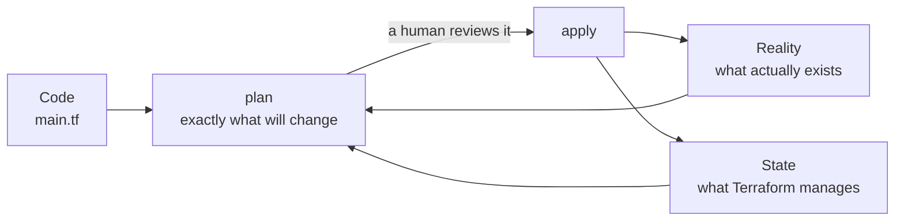

# Infrastructure as Code with Terraform

The PortoBikes story

<p class="opacity-70 pt-8">
PortoBikes is invented. Every incident in this talk really happened somewhere.
</p>

<!--
Meet PortoBikes: a bike-rental startup here in Porto. It's invented, but everything that happens to it in this talk has happened to a real company, and we'll show you which one.
-->

---
layout: center
class: text-center bg-black text-white
---

# Friday, 18:00.

## The booking server is down.

<!--
It's Friday, 18:00, peak rental time, and the booking server just died. It was set up by hand three years ago, by someone who has since left.

So: how long would it take *you* to rebuild it?

[pause]

Hold that number. We'll come back to it.
-->

---

<!-- ===== Turning point 3: Terraform arrives, plus the live demo (2017). S2 narrates, Alef drives the demo. ~13 min ===== -->

# Terraform almost didn't make it

<p class="opacity-60">📍 Real anchor</p>

- **July 2014:** Terraform v0.1 supports only **AWS** and **DigitalOcean**, chosen to prove that several **providers** could share one workflow
- Downloads were *"mostly stagnant for the first 18 months"*; the team talked about *"maybe shutting down the project"*

<v-click>

- **2017:** *"downloads continued to double every single month"*

</v-click>

<p class="absolute bottom-6 text-sm opacity-50">Mitchell Hashimoto, "The Story of HashiCorp Terraform"</p>

<!--
S2: PortoBikes, 2017. The scripts from last time describe the steps. What we want is something that describes the result. That tool existed, but it almost didn't survive.

In July 2014, Terraform 0.1 supported exactly two platforms, AWS and DigitalOcean. Two, on purpose: to prove that one workflow could drive several providers. Its creator, Mitchell Hashimoto, says downloads were "mostly stagnant for the first 18 months", and the team talked about "maybe shutting down the project".

[click] Then in 2017, "downloads continued to double every single month". So what did people suddenly see in it?
-->

---

# The core model



<p class="text-center pt-4 text-xl">You describe <b>what should exist</b>. <code>plan</code> shows exactly what will change, <b>before</b> anything happens.</p>

<!--
S2: Three inputs. The code: what we want. The state: Terraform's record of what it manages. And reality: what actually exists right now, which Terraform re-reads every time.

From those three it builds a plan: exactly what it would create, change or destroy. A person reads the plan. Only then does apply change anything.

This is the core idea of the whole talk: the change becomes something you can review.
-->

---

# Reading a plan

| Symbol | Meaning |
|---|---|
| <code class="text-green-500">+</code> | create |
| <code class="text-yellow-500">~</code> | change in place |
| <code class="text-red-500">-</code> | destroy |
| <code class="text-orange-500">-/+</code> | replace: destroy, then create |

<v-click>

```text
Plan: 1 to add, 0 to change, 1 to destroy.
```

</v-click>

<!--
S2: Four symbols, and you can read any plan. Plus: create. Tilde: change in place. Minus: destroy. And minus-slash-plus: replace, which means destroy and create again.

[click] At the bottom, a one-line summary. Watch for this exact line in a minute.
-->

---
layout: center
class: text-center
---

# → LIVE DEMO

<p class="text-2xl pt-4">Alef switches to the terminal</p>

<p class="opacity-60 pt-8">Our booking server, written down as code</p>

<!--
HAND-OFF TO THE DEMO. S2: "Let's see it. Alef, over to you." Alef switches the projector to the terminal running demo/demo.sh. Keep this slide up in the presenter view: these notes are S2's lines.

If the demo fails at any point: switch back to the slides and go to the NEXT slide (the backup recording). If it works, skip the next slide.

Step 1, `cat main.tf`, `terraform apply` (Plan: 2 to add), `curl localhost:8080` → "PortoBikes — 5 EUR per hour":
"This is our booking server, written down."

During step 1 or 2, one sentence:
"By the way, this Docker provider is maintained by one volunteer, not by HashiCorp. Remember that when we talk about who controls these tools."

Step 2, the price changes in main.tf → `terraform plan -out=tfplan` → "must be replaced", "forces replacement", "Plan: 1 to add, 0 to change, 1 to destroy.":
"Before touching anything, it tells us exactly what it will do. And notice: this replaces the server. In production that means downtime, and we found out before pressing enter."

Step 3, `terraform apply tfplan` → "Resources: 1 added, 0 changed, 1 destroyed." → the new price is live:
"What we reviewed is exactly what runs. Nothing gets recalculated."

Step 4, `docker rm -f portobikes-web` → the page stops loading:
"Friday, 18:00."

Step 5, `terraform plan -out=tfplan` → "will be created", "Plan: 1 to add":
"Terraform re-read reality, saw the server is gone, and wants to put it back. That's drift detection."

Step 6, `terraform apply tfplan` → "Resources: 1 added", no `yes` prompt → the page is back:
"So, how long did it take you to rebuild yours?"

The terminal then shows "Back to the slides". DON'T DESTROY: the server keeps running until the debate, where OpenTofu takes it over. Leave the terminal window open.

Demo-day warnings:
- Terraform does NOT print "Objects have changed outside of Terraform" when the container is deleted. The plan just says "will be created". Don't promise the class a warning message.
- Never use -refresh=false or -minimal-refresh: both hide the drift.
- Before the talk: terraform init on the demo laptop, nginx:alpine pre-pulled, port 8080 free, DOCKER_HOST set on Colima (demo/README.md). demo.sh checks these. The provider version is pinned by the committed .terraform.lock.hcl.
-->

---
layout: center
class: text-center
---

# Backup: the demo, recorded

<video src="/recording.mp4#t=0,79.9" controls preload="auto" class="mx-auto max-h-[55vh] rounded shadow"></video>

<p class="text-sm opacity-50 pt-2">Only if the live demo fails. Same steps, same output: it stops when turning point 3 is done.</p>

<!--
ONLY IF THE LIVE DEMO FAILED. If the demo worked, skip this slide.

Press play. S2 says the same lines as in the demo notes on the previous slide, a little behind the video. The video stops by itself at step 6's "Apply complete! Resources: 1 added" (about 1:20). Say "and the page is back" yourself: the frame that shows the page also shows the OpenTofu line from the debate, so the video stops just before it.

If the live demo died partway through, drag the video to where it died: apply at the start, the price change after about 0:30, the deletion after about 0:55.
-->

---
layout: center
class: text-center
---

# ← Back to the slides

<div class="text-2xl leading-loose pt-4">

What we reviewed is exactly what ran.

The server died, and `plan` put it back.

</div>

<!--
RETURN FROM THE DEMO. Alef switches the projector back to the slides. The terminal stays open with the server running: the debate uses it.

S2: "So: what we reviewed is exactly what ran. And when someone deleted the server by hand, the plan noticed and put it back."
-->

---

# Same workflow, another platform

<div class="grid grid-cols-2 gap-6">

<div>

**The demo** (Docker)

```hcl
provider "docker" {}

resource "docker_container" "web" {
  name  = "portobikes-web"
  image = docker_image.nginx.image_id
  # ...
}
```

</div>

<div>

**PortoBikes on AWS** <span class="opacity-50">(a sketch, not run)</span>

```hcl
provider "aws" {
  region = "eu-south-2"
}

resource "aws_instance" "web" {
  ami           = var.ami_id
  instance_type = "t3.micro"
  # ...
}
```

</div>

</div>

<p class="pt-4">Swap the <b>provider</b> and its resource types. <code>init</code> → <code>plan</code> → <code>apply</code> stays the same.</p>

<!--
BACKUP SLIDE: show it if someone asks "but that's just Docker on a laptop", otherwise skip it.

S2: The demo ran on Docker so it costs nothing and needs no Wi-Fi. For AWS you'd switch the provider and use AWS's resource types, but the workflow is the same: init, plan, review, apply. That's the multi-provider bet from 2014.

Be honest if asked: the AWS side is a sketch for the slide, not code we ran.
-->

---

# How Terraform changed, 0.x → 1.x

<div class="text-[0.85em] [&_td]:py-1 [&_th]:py-1">

| Version | When | What changed |
|---|---|---|
| 0.1 | Jul 2014 | AWS and DigitalOcean only |
| 0.12 | May 2019 | HCL2: a real expression language |
| 0.13 | Aug 2020 | Providers installed from the Registry |
| **1.0** | **Jun 2021** | **A compatibility promise: upgrades within 1.x keep your configuration working** |
| 1.5 | Jun 2023 | Import through a plan |
| 1.6 | Oct 2023 | `terraform test`, and the first BSL release |
| 1.11 | Feb 2025 | S3 locks state itself |
| 1.17 | Oct 2026 | Terraform Policy is generally available |

</div>

<v-click>

<p class="text-xl pt-2">After 1.0, new features increasingly work <b>through the plan</b>.</p>

</v-click>

<!--
S2: How did it change since it started? 0.1 had two providers. 0.12, in 2019, made HCL a real language. 0.13 is why `source = "kreuzwerker/docker"` just worked in the demo: providers come from the Registry.

1.0, in June 2021, is the maturity line: HashiCorp promised that upgrades within 1.x keep your configuration working.

After that: 1.5 lets you import hand-made infrastructure through a reviewed plan. 1.6 adds `terraform test`, and it's also the first release under the BSL; keep that in mind for later. 1.11: S3 locks state by itself, which matters in a minute when the team grows. And last month, 1.17: Terraform Policy, rules checked against every plan.

[click] Notice the pattern: after 1.0, new features increasingly work through the plan. Which is exactly what PortoBikes needs next, because the team is about to grow.
-->

---

# 2019: ten engineers, one state file

- Two people run `terraform apply` at once: both read the same old **state**, and one write is lost
- Fix: shared remote state with **locking**. Terraform locks state on every operation that writes it
- Since Terraform 1.11 (Feb 2025), S3 locks state itself; the DynamoDB lock table is deprecated

```hcl {6}
terraform {
  backend "s3" {
    bucket       = "portobikes-state"
    key          = "prod/terraform.tfstate"
    region       = "eu-west-1"
    use_lockfile = true # defaults to false: forget it, and there is no lock
  }
}
```

<p class="text-sm opacity-80">Terraform docs: state locking; S3 backend; 1.11 changelog.</p>

<!--
[S2]

Fast-forward to 2019. PortoBikes has grown to ten engineers, and they all run Terraform from their own laptops.

Here's the problem. Terraform keeps its state, its record of what it manages, in a file. If two people run apply at the same moment, both read the same old state, both write, and one of the writes is lost. Now you have infrastructure that exists, but that Terraform no longer knows about.

The fix is to put the state in one shared place, with a lock. Terraform takes the lock automatically on every operation that writes state. If someone else already holds it, Terraform stops instead of writing.

On AWS, the classic setup was an S3 bucket for the state and a DynamoDB table for the lock. Since Terraform 1.11, in February 2025, S3 can hold the lock itself, and the DynamoDB arguments are deprecated.

[point at the highlighted line] One trap: this setting defaults to false. Forget that line, and you have shared state with no lock at all.
-->

---

# Every change is a pull request

1. Open a pull request with the HCL change
2. CI runs `terraform plan` and posts it to the pull request
3. A colleague reviews the **plan**, not just the code
4. Approval, then `apply`

<div class="grid grid-cols-3 gap-4 pt-6 text-center">
  <div class="border-2 border-current rounded p-3"><b>Atlantis</b><br>open source, self-hosted</div>
  <div class="border-2 border-current rounded p-3"><b>GitHub Actions</b><br>runs the plan in CI</div>
  <div class="border-2 border-current rounded p-3"><b>HCP Terraform</b><br>HashiCorp's hosted service</div>
</div>

<p class="pt-6">Why review the plan? A three-line diff can hide a replaced database. The plan says <code>must be replaced</code>.</p>

<!--
[S2]

With ten engineers, nobody should be running apply from a laptop anyway. So the change process becomes a pull request.

You open a pull request with your change. CI runs terraform plan and posts the result on the pull request. A colleague reviews it. And here's the important part: they review the *plan*, not just the code. Only after approval does anything get applied.

Why the plan? Because a three-line change in the code can hide something destructive, like an attribute that forces the database to be replaced. The code diff looks harmless. The plan says "must be replaced". You saw exactly that in the demo, when changing a price replaced our server.

Three tools implement this same loop. Atlantis is open source and self-hosted. You comment "atlantis plan" on the pull request, and it can refuse to apply until someone other than the author has approved. GitHub Actions can run the plan in CI. And HCP Terraform, HashiCorp's hosted service, plans every pull request on its own.

This is where the talk's argument becomes concrete: reviewable code became reviewable change.
-->

---

# Where IaC sits in a DevOps pipeline

<div class="flex flex-col gap-6 pt-4 text-xl font-semibold">
  <div>
    <div class="text-sm uppercase tracking-wide opacity-80 pb-2">On the pull request</div>
    <div class="flex items-center gap-3">
      <div class="border-2 border-current rounded px-4 py-3 whitespace-nowrap">commit</div>
      <div class="text-3xl" aria-hidden="true">→</div>
      <div class="border-2 border-current rounded px-4 py-3 whitespace-nowrap">pull request</div>
      <div class="text-3xl" aria-hidden="true">→</div>
      <div class="border-2 border-current rounded px-4 py-3 whitespace-nowrap">CI: <code>init</code> + <code>plan</code></div>
      <div class="text-3xl" aria-hidden="true">→</div>
      <div class="border-4 border-amber-500 bg-amber-300 text-black rounded px-4 py-3">a human reviews the plan</div>
    </div>
  </div>
  <div>
    <div class="text-sm uppercase tracking-wide opacity-80 pb-2">After approval</div>
    <div class="flex items-center gap-3">
      <div class="text-3xl" aria-hidden="true">→</div>
      <div class="border-2 border-current rounded px-4 py-3 whitespace-nowrap">merge</div>
      <div class="text-3xl" aria-hidden="true">→</div>
      <div class="border-2 border-current rounded px-4 py-3 whitespace-nowrap"><code>apply</code> the saved plan</div>
      <div class="text-3xl" aria-hidden="true">→</div>
      <div class="border-2 border-current rounded px-4 py-3 whitespace-nowrap">app deploy</div>
    </div>
  </div>
</div>

<div class="pt-8 text-base">

HashiCorp: initialize, produce a plan, *"have a human operator review that plan"*, apply.<br>
DORA: version your "Terraform files" too; comprehensive version control *"predicts continuous delivery"*.

</div>

<!--
[S2]

So where does all this sit in a DevOps pipeline? Here's the whole picture.

[top row] A commit goes into a pull request. CI runs terraform init and terraform plan. And then, in yellow, the step this whole talk is about: a human reviews the plan.

[bottom row] After approval, the change is merged, CI applies a *saved* plan, so what runs is exactly what that plan showed, and only then does the application get deployed onto that infrastructure.

This isn't our invention. HashiCorp's own guide to running Terraform in automation lists the same four steps: initialize, produce a plan, "have a human operator review that plan", apply.

And DORA, Google's DevOps research programme, says teams should keep their Terraform files in version control, because comprehensive version control "predicts continuous delivery".

So that's the relationship between IaC and DevOps: the infrastructure goes through the same pull request, review and deploy loop as the application, and it comes first.
-->

---

# A plan people can review, machines can check

**Policy as code:** rules checked against every plan, before `apply`

<div class="grid grid-cols-3 gap-4 pt-6 text-center">
  <div class="border-2 border-current rounded p-3"><b>Sentinel</b><br>HashiCorp's own language</div>
  <div class="border-2 border-current rounded p-3"><b>OPA</b><br>open source, Rego</div>
  <div class="border-2 border-current rounded p-3"><b>Terraform Policy</b><br>written in HCL, built into Terraform 1.17 (Oct 2026)</div>
</div>

<p class="pt-6">HCP Terraform <em>"checks the Terraform plan against the policy set during each run"</em>. A failed policy can stop the run.</p>

<!--
[S2]

Once a plan is something a person can review, it's also something a machine can check. That's policy as code.

You write rules, like "no storage bucket open to the internet" or "nothing outside our region", and they're checked against every plan before apply. In HashiCorp's own words, HCP Terraform "checks the Terraform plan against the policy set during each run". If a policy fails, it can stop the run.

There are three main options. Sentinel is HashiCorp's own policy language. OPA, the Open Policy Agent, is open source and uses a language called Rego. And since Terraform 1.17, last month, there's Terraform Policy, written in HCL itself and built into the CLI, so policy checks no longer need the paid platform.

The reviewer is no longer only a colleague. It's a colleague plus a set of rules. Keep that in mind for the last part of the talk, when the one writing the code is an AI.
-->

---

# How HashiCorp makes money

<div class="grid grid-cols-2 gap-8 pt-4">
<div>

**Free**
- The Terraform CLI
- HCP Terraform's free tier, with remote runs and single sign-on

</div>
<div>

**Paid**: HCP Terraform, per resource per month
- $0.10, $0.47 or $0.99, depending on the tier
- More concurrent runs, drift detection, audit logs

</div>
</div>

<p class="pt-6">HashiCorp: <b>4,856 customers</b>, <b>946</b> of them paying over $100k a year</p>

<p class="text-sm opacity-80">Pricing page as of 2026-11-04; the two higher tiers are sold through sales, so these may be list prices. Customers: all HashiCorp products, quarter ending Oct 2024, the last report before IBM.</p>

<!--
[S2]

So who pays for all this? The Terraform CLI is free. Even HCP Terraform, HashiCorp's hosted service, has a free tier, and it already includes remote runs and single sign-on.

Teams pay for the things that only matter once you're a team. More applies running at the same time. Drift detection, which tells you when someone clicked something in the console in production. Audit logs, for when someone asks who changed what. HCP Terraform charges per managed resource per month: ten cents, forty-seven cents or ninety-nine cents, depending on the tier. Those are the prices on HashiCorp's pricing page as of the fourth of November; the two higher tiers go through sales, so treat them as list prices.

So people don't pay for the CLI. They pay for running it as a team: coordination and governance. And those needs grow with headcount, which is exactly what happened to PortoBikes.

For scale: in its last quarterly report before IBM bought it, HashiCorp had 4,856 customers, and 946 of them paid more than a hundred thousand dollars a year. That's all HashiCorp products, not just HCP Terraform.
-->

---

# Why job ads ask for it

<div class="grid grid-cols-2 gap-8 pt-6 text-center">
  <div>
    <div class="text-6xl font-bold">18.4%</div>
    <div class="pt-2">of respondents use Terraform</div>
    <div class="text-sm opacity-80">Stack Overflow survey 2025</div>
  </div>
  <div>
    <div class="text-6xl font-bold">~2,300</div>
    <div class="pt-2">UK job ads in 6 months, median salary <b>£75k</b></div>
    <div class="text-sm opacity-80">IT Jobs Watch, 6 months to 21 Nov 2026</div>
  </div>
</div>

<p class="pt-10">Our reading, not a measured fact: they ask for the team workflow (remote state, modules, CI/CD, policy).</p>

<!--
[S2]

This is also why so many job ads ask for Terraform.

In the 2025 Stack Overflow survey, 18.4% of respondents said they had done extensive work with Terraform in the past year. That measures usage, not jobs.

For jobs: in the UK, IT Jobs Watch counted about 2,300 permanent job ads mentioning Terraform in the six months to the twenty-first of November, with a median salary of seventy-five thousand pounds.

[re-check this number the day before; it's a rolling window]

And what do those jobs actually want? Our reading, not a measured fact: not someone who can type terraform apply on a laptop. They want the team workflow we just walked through: remote state, modules, CI/CD, policy. Every company at this stage needs someone who knows it.
-->

---

# Certifications

| Exam | Price | Length |
|---|---|---|
| Terraform Associate (004) | $70.50 | 1 h |
| Terraform Infrastructure Engineer Professional (002) | $200 | 90 min, incl. CI/CD, policy, and the MCP server with AI agents |
| Terraform Authoring and Operations Advanced | $295 | 4 h, hands-on labs |

<p class="pt-4">Three separate, current exams. Each is valid for 2 years; only Advanced includes a free retake.</p>

<p class="text-sm opacity-80">HashiCorp's official certification pages (checked 2026-11-04, names re-checked 2026-11-21).</p>

<!--
[S2]

And if you want proof that you know this workflow, HashiCorp sells three certifications.

The Associate is the entry point: seventy dollars fifty, one hour, multiple choice. Almost every term in this talk, state, locking, drift, plan, is one of its exam objectives.

The Professional costs two hundred dollars and takes ninety minutes. It covers exactly this turning point: CI/CD, policy as code, and even using the Terraform MCP server with AI coding agents.

The Advanced exam is two hundred and ninety-five dollars, four hours, with hands-on labs on AWS or Azure.

These are three separate, current exams. None replaced another. Each is valid for two years, and only the Advanced one includes a free retake.

[pause]

So PortoBikes now has a team, a pipeline, policies, and maybe a certified engineer or two. Everything depends on one tool, and one vendor: HashiCorp. In 2023, HashiCorp changed the rules.
-->

---
layout: center
class: text-center
---

# Friday, 18:00. The booking server is down.

<v-click>

```bash
terraform apply
```

</v-click>

<v-click>

## Back within seconds.

</v-click>

<!--
At the start, we asked how long it would take you to rebuild that server.

[click] terraform apply.

[click] You just watched it take seconds.
-->

---
layout: center
---

<p class="text-3xl leading-relaxed">
Terraform turned infrastructure into reviewable code, and everything since has been about who reviews it: colleagues, policies, and now AI.
</p>

<!--
Terraform turned infrastructure into reviewable code, and everything since has been about who reviews it: colleagues, policies, and now AI.
-->

---
layout: center
class: text-center
---

# Run the demo yourself


[github.com/Alef-Keuffer/terraform-portobikes](https://github.com/Alef-Keuffer/terraform-portobikes)

<!--
Everything you saw, the demo included, is in this repo. Scan the code and run it yourself. Thank you, and now your questions.
-->
